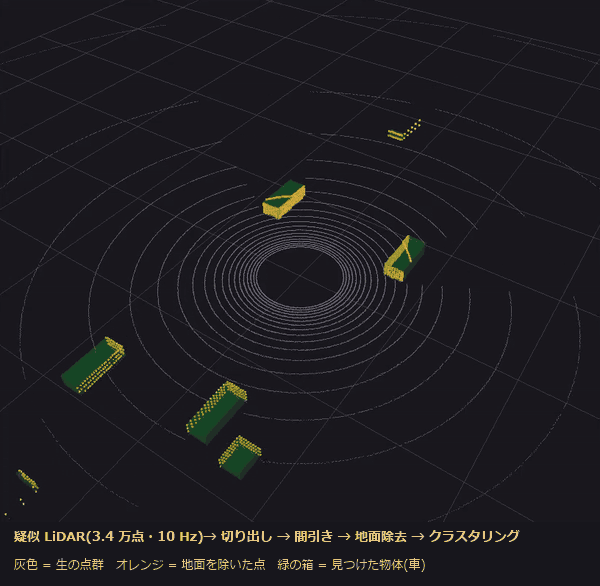

# PointCloudLatencyLab

LiDAR に似せた点群を流す、ROS 2(C++)の小さな前処理パイプライン。**各段の遅延と取りこぼしを自分で測れるようにし、「何が遅延を決めているか」を実験で確かめた**記録です。

```
sensor_sim ──▶ crop_box ──▶ voxel_downsample ──▶ ground_removal ──▶ cluster ──▶ 箱(MarkerArray)
疑似 LiDAR      範囲の切り出し   間引き(CPU / CUDA)      地面除去(RANSAC)       クラスタリング
3.4 万点 / 10 Hz
```



*RViz2 で表示したところ(`ros2 launch pcl_pipeline pipeline.launch.py`)。灰色が生の点群、オレンジが地面を除いた点、緑の箱がクラスタリングで見つけた物体(車 8 台)。10 秒、早送りなし。高画質の動画は [docs/demo.mp4](docs/demo.mp4)。*

## わかったこと(要約)

すべて 1 台のノート PC(i7-12700H、RTX 3060 Laptop、WSL2)で、各条件 30 秒 × 3 回ほど。数字は目安です。

| | 結果 | 詳しく |
|---|---|---|
| 1 | 別プロセスで 3.4 万点(約 550 KB)を渡すと、best_effort では **2〜3 割のフレームが黙って消える**。UDP の受信バッファ(上限 208 KB)があふれるため。平均の遅延だけ見ていると気づけない | [M2](#m220261105-段ごとの遅延と取りこぼし) |
| 2 | RViz2 で表示すると遅くなる原因は、描画ではなく、受け取る相手が 2 つになって **Cyclone DDS がマルチキャストに切り替わる**こと。データのマルチキャストを止めると戻る | [M2](#m220261105-段ごとの遅延と取りこぼし) |
| 3 | **1 プロセス + intra-process にすると、取りこぼし 0、受け渡し 4 回の合計 1.4 → 0.06 ms**(点の数を 2 倍にしてもほぼ同じ)。複数スレッドの executor は、一本道のパイプラインでは逆に遅い | [M3](#m320261105-1-プロセスにまとめるcomposable-node--intra-process) |
| 4 | CPU に負荷をかけると、遅れるのは受け渡しではなく処理そのもの(p99 3 → 19〜23 ms)。**CPU を分ける(taskset)のが一番効く**(p99 5.3〜5.6 ms)。reliable は取りこぼし 0 の代わりに **p99 が約 100 ms** に跳ねる | [M4](#m420261105-cpu-の負荷優先度cpu-の割り当てqos) |
| 5 | voxel の CUDA 版は、続けて呼ぶと 3.4 万点で 1.3〜1.8 倍、110 万点で約 5.6 倍速い。**しかし 10 Hz のパイプラインの中では CPU より遅い**。仕事の間隔が空くと GPU が休んだ状態(P8、約 215 MHz)のまま仕事をするため(100 ms ごとに呼ぶベンチマークで再現) | [M5](#m520261106-voxel-の-cuda-版) |

**English summary:** A small ROS 2 (C++, Jazzy) point-cloud preprocessing pipeline (crop → voxel downsample → RANSAC ground removal → Euclidean clustering) with per-stage latency logging. Findings, all measured: across processes, ~550 KB clouds lose 20–30% of frames under best_effort because of UDP receive-buffer overflow; RViz2 slows the pipeline because Cyclone DDS switches to multicast for a second reader; composing into one process with intra-process comms removes the loss and cuts hop latency from 1.4 to 0.06 ms; under CPU load, CPU partitioning beats `nice` and a multi-threaded executor; reliable QoS trades loss for ~100 ms p99; a CUDA voxel filter that is 1.3–5.6× faster back-to-back is slower than the CPU at 10 Hz because the GPU stays in a low-power state between frames.

## 動かし方

```bash
source env.sh                     # ROS 2 Jazzy + Cyclone DDS(+ WSL の GPU ドライバの場所)
colcon build --cmake-args -DCMAKE_BUILD_TYPE=Release
source env.sh                     # ビルド後にもう一度(install/ を読み込む)
ros2 launch pcl_pipeline composed.launch.py                 # おすすめ: 1 プロセス + intra-process
ros2 launch pcl_pipeline pipeline.launch.py                 # 別プロセス + RViz2(rviz:=false で表示なし)
ros2 launch pcl_pipeline composed.launch.py use_cuda:=true  # voxel を CUDA 版にする
./install/pcl_pipeline/lib/pcl_pipeline/voxel_bench 0.2 50 [100]  # voxel の CPU / GPU 比較([] は呼ぶ間隔 ms)
colcon test && colcon test-result --verbose                 # テスト
```

Docker(CPU 版。GitHub Actions も同じものを使う):

```bash
docker build -t pointcloud-latency-lab .   # ビルド + テスト(落ちたら失敗)
docker run --rm pointcloud-latency-lab     # パイプラインを動かしてログを出す
```

launch の主な引数: `rings`(点の数)、`rate_hz`、`csv_dir`(1 フレーム 1 行の CSV を書く)、`qos_reliable`、`use_cuda`、`ipc` / `container`(composed のみ)、`sink` / `rviz`(pipeline のみ)。

## テスト

| テスト | 内容 |
|---|---|
| `test_filters`(gtest、7 件) | 切り出し・間引き(重心、負の座標の floor)・地面除去(平面の推定)・クラスタリング(分離、点の数の上限)・疑似 LiDAR |
| `test_voxel_cuda`(gtest、2 件) | CUDA 版が CPU 版と同じ結果か(GPU がなければスキップ。CUDA なしのビルドでは作らない) |
| `test_pipeline_launch.py`(launch_testing) | パイプライン全体を起動し、15 秒以内に箱が 20 フレーム届くこと、箱の数が 4〜14(車は 8 台)であること |

CI(`.github/workflows/ci.yml`): push のたびに Docker の中でビルドとテスト、パイプラインを 15 秒動かしてログを確認。

## フォルダ

```
src/pcl_pipeline/
  include/pcl_pipeline/filters.hpp   点群の処理(ROS に依存しない)。node_util.hpp: 変換・QoS・測定。voxel_cuda.hpp
  src/filters.cpp, voxel_cuda.cu     処理の本体(CPU / CUDA)
  src/*_node.cpp                     ノード(部品として登録。単独の実行ファイルにもなる)
  src/voxel_bench.cpp                voxel の CPU / GPU のベンチマーク
  launch/                            pipeline.launch.py(別プロセス)、composed.launch.py(1 プロセス)
  test/                              gtest、launch_testing
src/m0_hello/                        M0 の環境確認用の最小の pub / sub
tools/                               実験のスクリプト(run_m2〜m5)と、CSV の分析(analyze_latency.py、summarize_*.py)
config/                              Fast DDS / Cyclone DDS の設定(M0・M2 の実験用)
results/                             測定の生データ(CSV)とまとめ(*_summary.txt)
```

## 環境

Windows 11 + WSL2(Ubuntu 24.04、`networkingMode=mirrored`)、ROS 2 Jazzy(apt の `ros-jazzy-desktop`)、RMW は Cyclone DDS。CPU は i7-12700H、GPU は RTX 3060 Laptop、CUDA は Ubuntu の `nvidia-cuda-toolkit` 12.0(ホストのコンパイラは gcc 12)。CUDA が見つからなければ CPU 版だけをビルドする。
WSL2 は native の Ubuntu ではないので、遅延の揺れ(p99・最大)は WSL の影響を受ける。

## まだ試していないこと

- SCHED_FIFO(実時間の優先度)。この WSL では root の設定変更が要るため。
- UDP の受信バッファを大きくする(`net.core.rmem_max`)。同じく PC の設定変更。
- GPU のクロックを固定して、M5 の原因を確定させる(Windows の管理者権限が要る)。
- native の Ubuntu での測定(WSL2 との違い)。
- 既定の Fast DDS で、別プロセスのノードがつながらなかった原因(M0)。

---

# 記録(マイルストーンごと)

各段階で「作る → 測る → 問題を見つける → 直す → 説明する」を、その日のうちに書いたものです。

## M0(2026/11/05): 環境の確認

| 確認 | 結果 |
|---|---|
| ROS 2 Jazzy の導入 | `tools/install_ros2_jazzy.sh`(公式の deb の手順。`apt upgrade` はしない) |
| talker / listener(既定の Fast DDS) | **別プロセスだと 1 件も届かない**。1 プロセスにまとめる(`composition manual_composition`)と届く |
| 同じ(Cyclone DDS) | 届く(6 秒で 6 件 / 5 件)。→ このプロジェクトは Cyclone DDS に固定(`env.sh`) |
| colcon でのビルド | `src/m0_hello`(Release)が 16 秒でビルドできた |
| 別プロセスの pub / sub(Cyclone、100 Hz、`Header` だけ) | 片道の遅延 p50 136〜181 µs、p99 304〜806 µs、最大 348〜914 µs(1 秒ごと × 6 回。1 回だけの測定) |
| RViz2(WSLg) | 起動し、OpenGL 4.5 で初期化できた(点群の表示は M1 で確認) |

### Fast DDS で別プロセスがつながらない件(未解決)

確かめたこと(`tools/m0_pubsub_check.sh` で、届いた件数を数える):

- ネットワークは通る: Python で 127.0.0.1・eth2 への UDP、マルチキャスト(239.255.0.1)はどれも届く。
- strace で見ると、talker と listener は探索のパケットをお互いに送り合っている(listener は 3〜6 KB のエンドポイント情報も受け取っている)。それでもトピックがつながらない。
- 効かなかったもの: `ROS_AUTOMATIC_DISCOVERY_RANGE=LOCALHOST`、`ROS_STATIC_PEERS=127.0.0.1`、`FASTDDS_BUILTIN_TRANSPORTS=UDPv4`(共有メモリなし)、127.0.0.1 だけに限る XML(`config/fastdds_localhost.xml`)、`ROS_DOMAIN_ID=42`。
- 同じ PC・同じ手順で Cyclone DDS は届く → Fast DDS(2.14.7、rmw_fastrtps_cpp 8.4.4)とこの環境の組み合わせの問題。
- 仮説: mirrored モードで lo に付く 10.255.255.254 などの、Fast DDS が送り先に使うアドレス・ポートの扱い。PC の設定(`.wslconfig`)を変えずに進められるので、今は深追いしない。

## M1(2026/11/05): 5 つのノード(CPU 版、別プロセス)

```
sensor_sim --/sensor/points--> crop_box --/cropped/points--> voxel_downsample --/downsampled/points-->
  ground_removal --/ground_removed/points--> cluster --/objects/markers(MarkerArray)--> RViz2
```

| ノード | やること | 主なパラメータ |
|---|---|---|
| `sensor_sim` | 疑似 LiDAR。32 本 × 1 周 1800 方向の光線を、地面(z = -1.8 m)と 8 台の車(4.5 × 1.8 × 1.5 m、4 車線を流れる)に当てる | `rings`、`azimuth_steps`、`rate_hz`(10)、`num_cars` |
| `crop_box` | ±50 m、高さ -2.5〜1.0 m の範囲だけ残し、自車の範囲を除く | `min_x` 〜 `max_z` |
| `voxel_downsample` | 20 cm の立方体ごとに重心 1 点にまとめる(ハッシュ表) | `leaf_size` |
| `ground_removal` | RANSAC(50 回)で水平に近い平面を探し、20 cm 以内の点を除く | `distance_threshold`、`ransac_iterations` |
| `cluster` | 60 cm 以内でつながる点を塊にし、箱を出す(格子で近くの点を探す) | `cluster_tolerance`、`min_points`、`max_points` |

設計で決めたこと:

- 点群の処理は `filters.cpp` に、ROS に依存しない関数として分けた。ノードは「受け取る → 呼ぶ → 送る」だけ。M5 の CUDA 版との比較と、M6 の gtest で同じ関数を使う。
- `Point`(float × 4 = 16 バイト)を PointCloud2 の並びと同じにして、変換は memcpy 1 回。
- `header.stamp`(センサーで付けた時刻)を最後の段まで引き継ぎ、各段で「処理時間」と「センサーからの経過時間」を記録する(50 フレームごとにログ)。
- 点群の QoS は best_effort・最新 5 件(遅れたら捨てる)。箱は reliable(取りこぼすと古い箱が残る)。
- 送るときは `unique_ptr` で渡す(M3 で 1 プロセスにまとめたとき、コピーなしで渡せる形)。

### 測定(10 Hz、50 フレームの平均。1 回だけ)

表示なし(`rviz:=false`、15 秒):

| 段 | 点の数(入 → 出) | 処理時間 平均 / 最大 | センサーからの経過 平均 / 最大 |
|---|---|---|---|
| sensor_sim | — → 34,220 | 2.9 / 4.1 ms(点群を作る時間) | — |
| crop_box | 34,220 → 33,190 | 0.20 / 0.57 ms | 1.1〜1.3 / 2.0〜3.1 ms |
| voxel_downsample | 33,190 → 10,600〜11,400 | 1.0〜1.1 / 1.9 ms | 2.8〜2.9 / 6.2 ms |
| ground_removal | 10,600〜11,400 → 740〜970 | 0.3〜0.4 / 0.7 ms | 3.5〜3.6 / 7.7 ms |
| cluster | 740〜970 → 箱 8〜9 個 | 0.3 / 0.5 ms | **4.1 / 8.1 ms** |

- 箱の数は車の台数(8)とほぼ合う。RViz2 で、灰色の点群・オレンジの障害物の点・緑の箱が、車線に沿って動くのを確認した。
- 処理時間の合計は約 2 ms なのに、端から端までは約 4 ms。差の約 2 ms は、4 回のノード間の受け渡し(シリアライズ、DDS、受け取り側が起きるまで)だと考えている → M2 で段ごとに分けて測り、M3 で 1 プロセスにまとめて比べる。

RViz2 で表示しながら(同じ設定):

- cluster のセンサーからの経過が **平均 7.5〜7.9 ms、最大 14〜15 ms** に伸びた(表示なしの約 2 倍)。各段の処理時間は変わらない。最初の crop_box に届くまでが 1.1 → 4.9〜5.5 ms に伸びている。
- 仮説(未確認): RViz2 が `/sensor/points`(約 550 KB / フレーム)も受け取るので、sensor_sim が 2 か所へ送るようになり、さらに RViz2 の描画が CPU を使う。M2 で「RViz2 なし + 同じトピックを受け取るだけのノード」と比べて、どちらが効いているかを分ける。

## M2(2026/11/05): 段ごとの遅延と取りこぼし

### 測り方

- 各ノードが 1 フレーム 1 行を CSV に書く(`csv_dir:=...`。`stamp_ns`(センサーの時刻)、`recv_ns`(受け取って処理を始めた時刻)、`done_ns`(送る直前))。時刻は同じ PC の ROS の時計なので、ノードをまたいで引き算できる。
- `tools/analyze_latency.py`: センサーの時刻でつなぎ、**受け渡し(hop)= 次の段の recv - 前の段の done**、**処理(proc)= done - recv** に分けて p50 / p99 / 最大を出す。
- `tools/run_m2.sh`: 条件ごとに 30 秒 × 3 回。同時に OS の UDP 受信バッファあふれ(`/proc/net/snmp` の RcvbufErrors)も記録。`tools/summarize_m2.py` で 1 行ずつにまとめる(最初の 20 フレームと最後の 5 フレームは除く)。
- 条件: base(5 ノードだけ)/ sink(`/sensor/points` を受け取るだけのノードを足す)/ rviz(RViz2 で表示)/ rings16・rings64(点の数を半分・2 倍)。

### 結果(`results/m2_summary.txt`。各 30 秒・約 270 フレーム × 3 回)

| 条件 | 1 フレームの点(大きさ) | 取りこぼし | UDP 受信あふれ | 受け渡し 4 回の合計 p50 / p99 | 端から端 p50 / p99 |
|---|---|---|---|---|---|
| base | 34,219(約 550 KB) | **19〜33%** | 471〜893 | 1.4〜1.5 / 1.9〜2.9 ms | 3.2〜3.6 / 4.1〜5.5 ms |
| sink | 同じ | 2〜3% | 108〜295 | **5.1〜6.6 / 13〜14 ms** | 7.0〜8.4 / 14.6〜16.0 ms |
| rviz | 同じ | 1.5〜1.9% | 228〜455 | 5.0〜6.2 / 11〜12.5 ms | 7.0〜8.2 / 13.0〜14.5 ms |
| rings16 | 16,331(約 260 KB) | **0%** | **0** | 1.1 / 1.5〜2.1 ms | 2.1〜2.2 / 2.6〜3.3 ms |
| rings64 | 68,510(約 1.1 MB) | **23〜51%** | 1,399〜3,062 | 2.5 / 3.3〜4.0 ms | 6.4〜6.6 / 7.6〜9.5 ms |

各段の処理時間(base、p50): crop_box 0.18、voxel_downsample 0.98、ground_removal 0.29、cluster 0.29 ms。どの条件でもほぼ変わらない。

### わかったこと 1: 大きいフレームは、best_effort だと UDP の受信バッファあふれで落ちる

- 取りこぼしは、大きいフレームを渡す最初の 2 回の受け渡し(sensor_sim → crop_box、crop_box → voxel_downsample。どちらも 3.4 万点)だけで起きる。間引いた後(1 万点、千点)の受け渡しでは 0。
- 点の数と一緒に増える: 半分(260 KB)で 0%・あふれ 0、そのまま(550 KB)で 19〜33%、2 倍(1.1 MB)で 23〜51%。
- この PC の受信バッファの上限は `net.core.rmem_max = 212992`(208 KB)で、1 フレームより小さい。1 フレームは UDP の多くのパケットに分かれて一度に届くので、受け取り側がすぐに読めないとバッファがあふれ、1 つでも欠けると best_effort ではフレームごと捨てられる。
- M1 では段ごとの件数を比べていなかったので、気づかなかった。**平均の遅延だけ見ていると、2〜3 割のフレームが消えていても見えない。**
- 直し方の候補(M3・M4 で比べる): 1 プロセスにまとめる(DDS を通らない)、QoS を reliable にする(落ちたら送り直す。遅延は伸びるはず)、受信バッファを大きくする(`sysctl` は PC の設定変更なので、やるときは本人の判断)。

### わかったこと 2: 受け取る相手が 2 つになると遅くなるのは、Cyclone DDS がマルチキャストに切り替わるため

- M1 の「RViz2 で表示すると約 2 倍遅い」は、描画のせいではなかった。受け取るだけのノード(sink)を足しただけで、同じくらい遅くなる。
- 遅くなるのは、`/sensor/points` の受け渡し(sensor_sim → crop_box)だけ: p50 0.49 → 5.8 ms、p99 0.91 → 12.8 ms(3 回目の内訳)。他の受け渡しと処理は変わらない。
- 仮説: 受け取る相手が 2 つ以上になると、Cyclone DDS はデータをマルチキャストで送る。WSL2 の mirrored モードでは、マルチキャストは本物の NIC(eth2)を通るので、loopback より遅い。
- 確かめた: データのマルチキャストを止める(`config/cyclone_unicast.xml`、`AllowMulticast=spdp`。探索だけマルチキャスト)と、遅くならない(`results/m2_unicast_summary.txt`、各 2 回):

| 条件(データはユニキャストだけ) | 取りこぼし | 受け渡しの合計 p50 / p99 | 端から端 p50 / p99 |
|---|---|---|---|
| base | 22〜23% | 1.4〜1.5 / 2.7〜2.8 ms | 3.2〜3.5 / 4.9〜5.4 ms |
| sink | 7〜20% | 1.6〜1.7 / 2.5 ms | 3.4〜3.5 / 4.4〜5.1 ms |
| rviz | 2〜4% | 1.9〜2.0 / 2.6 ms | 3.8〜4.0 / 4.9 ms |

- まだわからないこと: 受け取る相手を足すと、最初の受け渡しの取りこぼしが減る(base 36〜44 件 → sink・rviz 0〜3 件)。マルチキャストでも、ユニキャストでも。送る側が 2 か所へ順に送るので、1 か所あたりの届く勢いが落ち、バッファがあふれにくくなるのではないかと考えている(未確認)。

### 進め方の反省

- 測り始めは 10 秒の試し(1 回)で取りこぼしに気づいた。CSV に件数を残す形にしていなければ、見逃していた。
- 実験中に WSL 全体が応答しなくなり、再起動した(カーネルのログに、`nvidia-ctk` などでの soft lockup)。パイプラインを動かしていない時に起きたので、この作品が原因ではないと考えているが、未確認。

## M3(2026/11/05): 1 プロセスにまとめる(composable node + intra-process)

### 変えたこと

- 6 つのノードを部品(component)にして、1 つの共有ライブラリ `pipeline_components` に入れた。`rclcpp_components_register_node` が部品ごとの単独の実行ファイルも作るので、別プロセスの起動(`pipeline.launch.py`)はそのまま使える。
- `launch/composed.launch.py`: 5 つを 1 つの component container に読み込む。`ipc:=true/false`(intra-process 通信)、`container:=component_container_mt`(複数スレッドの executor)を切り替えられる。
- 送る側は M1 から `unique_ptr` で publish しているので、intra-process では同じプロセスの中のメッセージを、コピーせずにそのまま次のノードへ渡せる(受け取る相手が 1 つのとき)。

### 結果(`results/m3_summary.txt`。各 30 秒・約 270 フレーム × 3 回。`tools/run_m3.sh`)

| やり方 | 点の数 | 取りこぼし | UDP 受信あふれ | 受け渡し 4 回の合計 p50 / p99 | 端から端 p50 / p99 |
|---|---|---|---|---|---|
| 別プロセス(procs) | 34,219 | **20〜26%** | 639〜723 | 1.32〜1.44 / 1.9〜2.4 ms | 3.1〜3.4 / 4.2〜4.7 ms |
| 1 プロセス、intra-process なし(comp_dds) | 同じ | **0%** | 0 | 0.30〜0.68 / 0.67〜1.27 ms | 2.0〜2.6 / 2.7〜3.7 ms |
| 1 プロセス、intra-process(comp_ipc、1 スレッド) | 同じ | **0%** | 0 | **0.06 / 0.31〜0.32 ms** | **1.8〜1.85 / 2.6〜3.1 ms** |
| 同じ + 複数スレッド(comp_ipc_mt) | 同じ | 0% | 0 | 0.32〜0.35 / 0.71〜1.07 ms | 2.2〜2.3 / 3.2〜3.6 ms |
| 別プロセス | 68,509 | **25〜31%** | 1,387〜1,707 | 2.30〜2.60 / 3.1〜3.5 ms | 6.1〜6.8 / 7.5〜8.3 ms |
| comp_dds | 同じ | 0% | 0 | 0.51〜0.54 / 0.98〜1.44 ms | 3.8〜3.9 / 4.9〜5.6 ms |
| comp_ipc | 同じ | 0% | 0 | **0.07 / 0.33〜0.83 ms** | **3.4〜3.45 / 4.3〜5.0 ms** |
| comp_ipc_mt | 同じ | 0% | 0 | 0.36〜0.38 / 0.83〜1.31 ms | 3.9〜4.0 / 5.3〜5.9 ms |

受け渡しごとの p50(34,219 点、3 回目): 

| 受け渡し | procs | comp_dds | comp_ipc |
|---|---|---|---|
| sensor_sim → crop_box(550 KB) | 0.51 ms | 0.14 ms | 0.029 ms |
| crop_box → voxel_downsample(530 KB) | 0.42 ms | 0.087 ms | 0.009 ms |
| voxel_downsample → ground_removal(170 KB) | 0.24 ms | 0.046 ms | 0.012 ms |
| ground_removal → cluster(15 KB) | 0.17 ms | 0.017 ms | 0.007 ms |

### わかったこと

1. **1 プロセスにまとめると、取りこぼしが 0 になる。intra-process でなくても。** 同じプロセスの中では、Cyclone DDS はデータを UDP の受信バッファに通さずに渡すので、M2 の「受信バッファあふれ」が起きない(あふれの数もすべて 0)。
2. **intra-process は、受け渡しを約 20 分の 1 にする**(4 回の合計 p50: 別プロセス 1.4 ms → 1 プロセス 0.30 ms → intra-process 0.06 ms)。点の数が 2 倍になっても 0.06 → 0.07 ms でほぼ変わらない。大きさに比例しないので、メッセージをコピーせずに渡せていると考えている(ポインタが同じかは直接は確かめていない)。
3. **複数スレッドの executor は、このパイプラインでは遅くなる**(受け渡しの p50 0.06 → 0.33 ms)。5 つの段は前の段の結果を待つ一本道で、同時に動かせる仕事がない。複数スレッドにすると、次の段を別のスレッドが拾うまでの「起こす」時間が受け渡しごとに増えるだけ、と考えている。
4. **残りは処理そのもの。** intra-process の端から端(34,219 点で 1.8 ms)のうち、受け渡しは 0.06 ms だけで、ほとんどが各段の処理(voxel_downsample が約 1 ms)と、sensor_sim が点群を作ってから送るまで。点の数が 2 倍だと、処理が増えて 3.4 ms になる。各段の処理時間には、PointCloud2 と `std::vector<Point>` の間のコピー(memcpy、1 段 2 回)も入っている。これを減らすか、voxel を速くする(M5 の CUDA)のが次の手。

注意: CPU の使用率(PC 全体、20 論理 CPU)は、どの条件も 0.3〜0.7% で、差を言うには粗すぎた。比べるなら、プロセスごとの CPU 時間を測る(M4 で)。

## M4(2026/11/05): CPU の負荷・優先度・CPU の割り当て・QoS

### 測り方(`tools/run_m4.sh`。各 30 秒 × 3 回、34,219 点、10 Hz)

- 負荷: 論理 CPU の数(20)だけの bash の空回し(`stress-ng` は入れていない)。
- パイプライン自身の CPU 時間を、プロセスごとに `/proc/<pid>/stat` から測った(M3 の「PC 全体の使用率」は粗すぎたため)。
- **SCHED_FIFO(実時間の優先度)は試していない。** この WSL では `ulimit -r` が 0 で、使うには root の設定変更(limits.conf など)が要るため。代わりに root が要らない `nice`(負荷側の優先度を下げる)と `taskset`(CPU を分ける)を比べた。

### 結果(`results/m4_summary.txt`)

| 条件 | 取りこぼし | 受け渡し p50 / p99 | 端から端 p50 / p99 / 最大 | パイプラインの CPU |
|---|---|---|---|---|
| 1 プロセス + intra-process、負荷なし | 0% | 0.05〜0.06 / 0.3〜1.4 ms | **1.7〜1.8 / 2.9〜3.2 / 3.4〜6.2 ms** | 0.04 コア |
| 同じ + 負荷(普通の優先度) | 0% | 0.12 / 4.2〜8.1 ms | **9.5〜11.1 / 18.6〜23.5 / 20〜37 ms** | 0.12 コア |
| 同じ + 負荷を `nice 19` | 0% | 0.10〜0.11 / 0.7〜3.8 ms | 4.5〜5.1 / 9.5〜12.3 / 10〜28 ms | 0.10〜0.12 コア |
| 同じ + CPU を分ける(パイプライン 0-9、負荷 10-19) | 0% | 0.09〜0.10 / 0.4〜0.5 ms | **3.5〜3.8 / 5.3〜5.6 / 5.9〜8.4 ms** | 0.09 コア |
| 複数スレッドの executor + 負荷 | 0% | 0.48〜0.65 / 8〜13.7 ms | 7.6〜9.5 / 18.5〜25.8 / 26〜49 ms | 0.15 コア |
| 別プロセス、best_effort、負荷なし | 15〜29% | 1.28〜1.31 / 1.7〜1.9 ms | 3.1 / 3.7〜4.1 / 4.1〜4.7 ms | 0.05〜0.06 コア |
| 別プロセス、**reliable**、負荷なし | **0%** | 1.40〜1.48 / **102〜103 ms** | 3.2〜3.3 / **104〜105 / 105〜204 ms** | 0.07 コア |
| 別プロセス、reliable + 負荷 | 0.4〜0.8% | 23〜35 / 363〜423 ms | **32〜43 / 368〜428 / 464〜636 ms** | 0.18〜0.19 コア |

各段の処理時間 p50(2 回目): voxel_downsample は 負荷なし 0.96 ms → 負荷 6.4 ms → nice 2.6 ms → CPU を分ける 1.96 ms。

### わかったこと

1. **負荷をかけると、遅れるのは受け渡しではなく処理そのもの。** 受け渡しの p50 は 0.05 → 0.12 ms でほとんど変わらないが、voxel の処理は 0.96 → 6.4 ms(約 7 倍)。空回しと同じ CPU を取り合い、処理の途中で何度も CPU を取られる(パイプラインの CPU 時間も 0.04 → 0.12 コアに増える = 同じ仕事に 3 倍の CPU 時間がかかっている)。端から端の p99 は 3 → 19〜23 ms。
2. **負荷の優先度を下げる(`nice 19`)と半分くらいに戻る**(p50 4.5〜5.1、p99 9.5〜12.3 ms)が、負荷なしには戻らない。最大は 28 ms のときもあった。
3. **CPU を分ける(`taskset`)のが一番効く**(p99 5.3〜5.6 ms、最大 8.4 ms、揺れが小さい)。ただし、それでも処理は約 2 倍遅い(voxel 0.96 → 1.96 ms)。
   - 確かめた: 同じ Python の計算を CPU 0 で動かすと、何もないとき 97 ms、**別の物理コア(CPU 10-19)に空回しを置くだけで 194 ms**。コアを分けても、他のコアが忙しいと遅くなる。
   - 仮説(未確認): ノート PC なので、多くのコアが動くと電力・熱の上限で周波数(ターボ)が下がる。あるいは、WSL2 の仮想 CPU が、Windows 側で効率コア(E コア)に回される(i7-12700H は P コア 6 + E コア 8。WSL からは「10 コア × 2 スレッド」に見えていて、どれが E コアかわからない)。確かめるには Windows 側で周波数とコアの割り当てを見る必要がある。
4. **複数スレッドの executor は、負荷があってもやはり悪い**(p99 18.5〜25.8 ms、最大 49 ms)。一本道のパイプラインでは、スレッドを増やしても取り合う相手が増えるだけ。
5. **reliable は、取りこぼしを 0 にする代わりに、落ちたフレームが約 100 ms 遅れて届く**(p50 はほぼ同じ 3.2 ms なのに、p99 が 104 ms、最大 204 ms)。送り直しは「受け取れなかった」と伝わってから行われ、その周期が約 100 ms(1 フレームの間隔と同じくらい)なので、落ちた 2 割弱のフレームがまるごと 1 周期遅れる。Cyclone DDS の heartbeat の間隔が関係していると考えている(設定の値は未確認)。
6. **reliable + 負荷は最悪**(p50 32〜43 ms、p99 368〜428 ms、最大 636 ms)。受け取り側のスレッドが CPU を取れず、受信バッファあふれが 2〜3 倍に増え(1,807〜2,629)、送り直しがさらに増える。10 Hz のセンサーで 0.4 秒遅れた点群は、使いものにならない。

### ここまでのまとめ(M2〜M4)

- 大きい点群を別プロセスで渡すと、best_effort では 2〜3 割が落ち、reliable では落ちない代わりに 100 ms 単位で遅れる。どちらも、1 プロセス + intra-process にすれば起きない(取りこぼし 0、受け渡し 0.06 ms)。
- そのうえで遅延の揺れを決めるのは CPU の取り合い。CPU を分けるのが一番効き、優先度(nice)も効く。スレッドを増やすのは逆効果だった。
- まだ試していないこと: SCHED_FIFO(root の設定変更が要る)、受信バッファを大きくする(sysctl)、native の Ubuntu での測定。

## M5(2026/11/06): voxel の CUDA 版

### 作ったもの

- `src/voxel_cuda.cu`(`VoxelCuda`): 1 点ごとにボクセルの鍵(CPU 版と同じ 21 bit × 3)を作る → CUB の基数ソートで鍵ごとに並べる → `ReduceByKey` で同じ鍵の区間を足す → 点の数で割って重心。GPU のメモリと CUB の作業領域は持ち続け、点が増えたときだけ確保し直す。転送の時間は CUDA のイベントで、送る・計算・戻すに分けて測る。
- `voxel_bench`(ROS を使わない): 3,600〜110 万点で CPU 版と比べ、**結果が同じかも確かめる**(重心は自分のボクセルの中にあるので、ボクセルの番号で対応を取り、座標の差を見る。最大 7.9e-4 m(110 万点。GPU は float、CPU は double で足すため)、それ以外は 1e-5 m 以下)。
- `voxel_downsample` ノードに `use_cuda`(launch の `use_cuda:=true`)。

途中のつまずき:

- 最初の結果の確認は「座標で並べ替えて比べる」だったので、34,200 点以上で「違う」と出た。点の数は同じで、x がほぼ同じ 2 点の順番が CPU と GPU の丸めの違いで入れ替わり、そこから後ろが全部ずれていた。比べ方の誤りで、計算は合っていた。
- nvcc 12.0 は gcc 13 に対応していない → CMake で gcc 12 を指定。`-Wpedantic` を nvcc にも渡すと生成コードで大量の警告が出る → 警告は C++ だけに付ける。
- WSL では `LD_LIBRARY_PATH=/usr/lib/wsl/lib` が要る(`env.sh` に追加。MiniAI と同じ問題)。

### 結果 1: 続けて呼ぶと、約 1.6 万点から GPU が速い(`results/m5/voxel_bench_r1〜3.txt`、50 回の p50、3 回)

| 点の数 | CPU | GPU(全体) | うち 送る / 計算 / 戻す | GPU は何倍速いか |
|---|---|---|---|---|
| 3,600 | 0.07 ms | 0.44〜0.51 ms | 0.03 / 0.22〜0.29 / 0.10 | 0.14〜0.16 倍 |
| 16,304 | 0.43〜0.47 | 0.49〜0.56 | 0.03 / 0.26〜0.37 / 0.12 | 0.77〜0.96 倍 |
| **34,200(このパイプライン)** | 0.95〜1.02 | 0.57〜0.73 | 0.05〜0.07 / 0.28〜0.46 / 0.14〜0.15 | **1.3〜1.8 倍** |
| 138,680 | 3.5〜3.8 | 0.84〜0.93 | 0.24〜0.25 / 0.29〜0.35 / 0.21 | 4.0〜4.2 倍 |
| 1,106,083 | 22.5〜24.7 | 4.1〜4.3 | 1.87〜1.89 / 1.41 / 0.52 | 5.5〜5.7 倍 |

- 点が少ないと、GPU は呼び出しと待ちの固定のコスト(約 0.4 ms)で負ける。多いと、送る時間が一番大きくなる(110 万点で 4.3 ms のうち 1.9 ms。約 18 MB を 1.9 ms = 約 9 GB/s。普通のメモリからの転送)。
- このとき GPU は P0(SM 1,600〜1,700 MHz)で動いていた。

### 結果 2: パイプラインの中(10 Hz)では、GPU 版のほうが遅い(`results/m5_pipeline_summary.txt`、1 プロセス + intra-process、30 秒 × 3 回)

| 点の数 | voxel の処理 p50 CPU / GPU | 端から端 p50 CPU / GPU | GPU の状態(GPU 版のとき) |
|---|---|---|---|
| 34,218 | 1.00〜1.10 / **2.53〜2.82 ms** | 1.89〜2.04 / 3.53〜3.72 ms | P8(約 215 MHz)85〜88%、P0 7〜11% |
| 68,509 | 1.95〜2.13 / **3.51〜3.85 ms** | 3.42〜3.78 / 6.28〜6.41 ms | P8 85〜90%、P0 9〜12% |
| 138,724 | 3.70〜4.54 / **5.89〜6.32 ms** | 6.23〜7.53 / 10.8〜11.1 ms | P8 87〜88%、P0 8〜11% |

- ベンチマークでは 4 倍速かった大きさ(13.9 万点)でも、パイプラインの中では GPU 版が 1.4〜1.7 倍遅い。GPU 版の p99 も大きく揺れる(13.9 万点で 11〜26 ms)。

### 原因を確かめた: 「100 ms ごとに 1 回」だと、GPU は休んだ状態のまま仕事をする

`voxel_bench` に「1 回ごとに休む」オプション(第 3 引数、ms)を足し、パイプラインと同じ 100 ms 間隔で呼んだ(`results/m5/voxel_bench_interval{0,100}_r{1,2}.txt`、30 回の p50、2 回):

| 点の数 | GPU 続けて(送る / 計算) | GPU 100 ms ごと(送る / 計算) | CPU 続けて / 100 ms ごと | 100 ms ごとの GPU は何倍速いか |
|---|---|---|---|---|
| 34,200 | 0.48〜0.52 ms(0.05 / 0.21〜0.22) | **3.08〜3.16 ms(0.34 / 1.38〜1.39)** | 0.99〜1.05 / 1.14〜1.38 ms | **0.37〜0.44 倍** |
| 138,680 | 0.90〜0.96(0.19〜0.21 / 0.28〜0.30) | 6.28〜6.67(1.34 / 3.12〜3.14) | 3.6 / 4.2〜4.3 | 0.65〜0.67 倍 |
| 1,106,083 | 4.5(2.0 / 1.34〜1.36) | 22.5〜43.9(5.5〜10.6 / 12.5〜27.8) | 21.9〜22.6 / 23.4〜24.2 | 0.55〜1.04 倍 |

- 100 ms ごとに呼ぶと、GPU の計算は約 6 倍、送るのも約 6 倍遅くなる。SM のクロックの比(P8 の約 215 MHz と P0 の約 1,700 MHz、約 8 倍)に近い。GPU は仕事が来てからクロックを上げるが、1 回の仕事(数 ms)が終わるほうが早い、と考えている。送る時間まで遅くなるので、GPU のコアだけでなく、PCIe の速さやメモリのクロックも休んだ状態に落ちている可能性がある(未確認)。
- パイプラインの中では、さらに遅い(34,218 点で 2.5〜2.8 ms)。ベンチマークより大きい差の分は、PointCloud2 との変換(memcpy)と、GPU 版の時に crop_box(CPU だけの段)まで約 2 倍遅くなっていること(13.9 万点で 0.83 → 1.87 ms)。後者の理由は未確認(GPU が動くとノート PC の電力の配分が変わる、など)。
- **MiniAI の Phase 8 で見つけた「GPU が P8 に落ちて Run() が遅くなる」と同じ種類の問題。** 推論サーバーでは「host ネットワークのときだけ」だったが、ここでは「仕事の間隔が空くと」起きる。

### 結論と、直すなら

- **このパイプライン(10 Hz、1 フレーム 3.4 万点、voxel が CPU で約 1 ms)では、CPU 版のほうがよい。** GPU 版は、ベンチマークでは 1.3〜1.8 倍速いが、実際の使い方では 2.5 倍遅い。「単体で速い」と「システムの中で速い」は違った。
- GPU が得になるのは、GPU が休む暇がないとき(点がずっと多い、センサーが何台もある、同じ GPU で推論も動いている、など)。
- 試していない直し方:
  - GPU のクロックを固定する(`nvidia-smi --lock-gpu-clocks`。Windows の管理者権限が要る PC の設定変更なので、本人の判断)。効けば、休んだ状態が原因だと確定できる。
  - 合間に GPU を起こしておく(空の仕事を流し続ける)。電力を無駄に使う。
  - 送る時間を減らす: pinned memory(ページロックされたメモリ)、crop_box も GPU で行い、点群を GPU に置いたまま次の段へ渡す。
